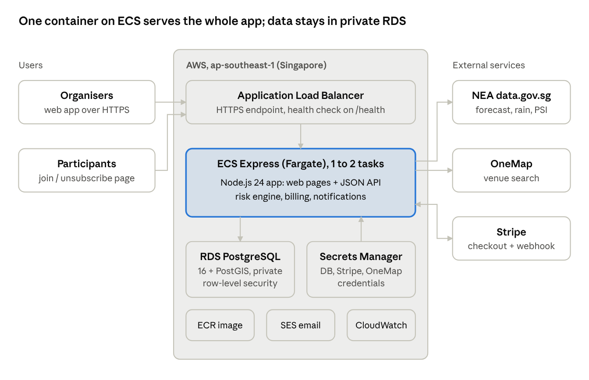

# RainReady

**Weather-risk decision support for outdoor events in Singapore.**

RainReady reads live NEA weather data for an event's venue, turns it into an explainable risk level for the event's start time, records the organiser's decision and emails participants when plans change. It is a multi-tenant SaaS built for NUS CS5224 Cloud Computing and deployed on AWS.

| | |
| --- | --- |
| **Live service** | https://ra-13c1809023724de59192ab160bdbf122.ecs.ap-southeast-1.on.aws/ |
| **Repository** | https://github.com/rainready-nus/rainready |
| **Status** | Course prototype: synthetic data only, Stripe in test mode |

## Contents

- [Features](#features)
- [Architecture](#architecture)
- [Tech stack](#tech-stack)
- [Repository structure](#repository-structure)
- [Getting started (local)](#getting-started-local)
- [Configuration](#configuration)
- [Deployment on AWS](#deployment-on-aws)
- [Testing](#testing)
- [API overview](#api-overview)
- [How the risk score works](#how-the-risk-score-works)
- [Security and privacy](#security-and-privacy)
- [Demo guide](#demo-guide)
- [Limitations and roadmap](#limitations-and-roadmap)
- [Contributing](#contributing)
- [Data sources and acknowledgements](#data-sources-and-acknowledgements)
- [Use of AI tools](#use-of-ai-tools)

## Features

- **Event management:** venue search through OneMap, date, time, activity type, weather sensitivity and an optional sheltered backup venue.
- **Event-time risk:** a 0–100 score and level (low, medium, high, critical) for the event's start, built from NEA forecasts, rainfall and sensitivity, with every input and reason shown.
- **Planning outlook:** a labelled planning estimate for events 2–4 days ahead from NEA's 4-day outlook.
- **Safety overrides:** a confirmed lightning alert forces "stop and seek shelter"; haze (PSI) is shown as a separate health advisory.
- **Decisions and audit trail:** continue, prepare, relocate, postpone or cancel, with a required reason.
- **Participant updates:** a join link with recorded consent; relocate, postpone and cancel decisions email every subscriber through Amazon SES, with one-click unsubscribe.
- **Organisations:** separate workspaces with owners and invited members, isolated by PostgreSQL row-level security.
- **Plans and billing:** Free (1 event, sponsored messages), Community (100 events, no ads, past events as templates) and Enterprise (500 events), with Stripe Checkout in test mode.
- **Demo tools:** a developer-only page to switch plans, add synthetic participants, read the email outbox and simulate extreme weather.

## Architecture



One Node.js container on **Amazon ECS (Express mode, Fargate)** serves both the web pages and the JSON API behind an HTTPS **Application Load Balancer**. Data lives in a private **Amazon RDS for PostgreSQL** database with PostGIS and row-level security. **AWS Secrets Manager** holds every credential, **Amazon SES** sends participant emails and **CloudWatch Logs** collects output. The app calls three external services: NEA's APIs on data.gov.sg, OneMap and Stripe.

Key design choices:

- **One modular service:** simpler to build, test and operate than microservices; Fargate adds a second copy under load.
- **PostgreSQL:** relational data, transactions for plan limits and row-level security for tenant isolation.
- **Weather on demand:** NEA data is fetched when an organiser opens an event, so there is no scheduler and nothing is fetched that nobody reads. Each source has an 8-second timeout and falls back to its last good reading.
- **Hosted payments:** card details stay on Stripe's page and never reach RainReady.

## Tech stack

| Layer | Technology |
| --- | --- |
| Backend | Node.js 24 (ES modules), built-in `node:http` and `node:sqlite`; runtime dependencies `pg` and `@aws-sdk/client-sesv2` only |
| Frontend | Plain HTML, CSS and JavaScript (single page), no build step |
| Database | PostgreSQL 16 + PostGIS (cloud and optional local); SQLite for zero-setup local runs |
| Cloud | Amazon ECS Fargate (Express mode), ECR, RDS, Secrets Manager, SES, CloudWatch, IAM |
| External | NEA real-time APIs (data.gov.sg), OneMap, Stripe |
| Tests | Node's built-in test runner; SQL tests for PostgreSQL |

## Repository structure

```text
rainready/
├── backend/
│   ├── server.mjs               HTTP server and all API routes
│   ├── risk-engine.mjs          scoring formula and risk bands
│   ├── risk-assessment.mjs      forecast selection for the event's start, planning outlook, PSI advisory
│   ├── weather-data.mjs         NEA API clients, nearest-location matching, last-good fallback
│   ├── geocoding.mjs            OneMap search with automatic token renewal
│   ├── auth.mjs                 accounts, sessions, organisations, invitations
│   ├── event-store-pg.mjs       PostgreSQL data access (event-store.mjs: SQLite)
│   ├── notifications.mjs        decision emails (outbox or SES)
│   ├── participants.mjs         join links, consent, unsubscribe
│   ├── billing.mjs              Stripe Checkout, webhook verification
│   ├── plans.mjs, ads.mjs       plan limits, sponsored messages
│   ├── deployment.mjs           cloud start-up checks (course-demo mode)
│   ├── db-setup.mjs             first-start database setup on AWS
│   ├── developer.mjs            developer-only demo tools
│   ├── weather-simulation.mjs   simulated extreme weather for demos
│   └── *.test.mjs               automated tests
├── frontend/
│   ├── index.html               organiser app
│   └── join.html                public join and unsubscribe page
├── database/postgres/
│   ├── init/                    schema, row-level security, reference data
│   ├── migrations/              001–004
│   ├── tests/                   SQL tests (tenant isolation, safety rules, location query)
│   └── docker-compose.yml       local PostgreSQL + PostGIS
├── deploy/aws/                  IAM policies and ECS settings; step-by-step guide
├── docs/                        API contract, data sources, user flow
├── Dockerfile                   production container image
└── .env.example                 configuration template
```

## Getting started (local)

### Prerequisites

- Node.js **24.15 or later**
- Optional: Docker Desktop, for a local PostgreSQL
- Optional: a free [OneMap API account](https://www.onemap.gov.sg/apidocs/) for venue search

### Run

```sh
git clone https://github.com/rainready-nus/rainready.git
cd rainready
npm install
cp .env.example .env        # then add ONEMAP_API_EMAIL and ONEMAP_API_PASSWORD
npm start
```

Open http://127.0.0.1:8787 and choose **Create account**. Data is stored in `backend/data/rainready.sqlite` (ignored by Git). Without OneMap credentials, everything except live venue search works.

### Use PostgreSQL locally (optional)

```sh
cd database/postgres
cp .env.example .env        # set the passwords
docker compose up -d
```

Then set `RAINREADY_DB_DRIVER=postgres` and the `RAINREADY_DB_*` settings in the root `.env`, and restart with `npm start`. See [database/postgres/README.md](database/postgres/README.md).

## Configuration

All configuration is through environment variables: a `.env` file locally, ECS service settings in the cloud. `.env.example` documents every variable. Never commit `.env`.

| Variable | Purpose | Default |
| --- | --- | --- |
| `PORT` | HTTP port | `8787` |
| `RAINREADY_DEPLOYMENT` | `local`, or `course-demo` for AWS (requires PostgreSQL with verified TLS, secure cookies, trusts the load balancer) | `local` |
| `RAINREADY_DB_DRIVER` | `sqlite` or `postgres` | `sqlite` |
| `RAINREADY_DB_HOST`, `_PORT`, `_NAME`, `_USER`, `_PASSWORD` | PostgreSQL connection (app role `rainready_app`) | local Docker values |
| `RAINREADY_DB_SSL`, `RAINREADY_DB_SSL_CA` | `off`, `verify-ca` or `verify-full`; CA bundle path | `off` |
| `RAINREADY_DB_SETUP`, `RAINREADY_DB_ADMIN_USER`, `RAINREADY_DB_ADMIN_PASSWORD` | First start on AWS only: create the database, schema and app role | off |
| `ONEMAP_API_EMAIL`, `ONEMAP_API_PASSWORD` | OneMap venue search; the token is renewed automatically | none |
| `RAINREADY_STRIPE_SECRET_KEY` | Stripe test key (`sk_test_` or `rk_test_`; live keys are refused) | payments off |
| `RAINREADY_STRIPE_PRICE_COMMUNITY`, `RAINREADY_PLAN_COMMUNITY_PRICE` | Stripe price ID and the price label shown in the app | none |
| `RAINREADY_STRIPE_WEBHOOK_SECRET` | Stripe webhook signing secret (`whsec_…`) | none |
| `RAINREADY_MAILER`, `RAINREADY_MAIL_FROM` | `outbox` or `ses`; verified sender address | `outbox` |
| `RAINREADY_PUBLIC_URL` | Base URL in email links; derived from the request when unset | request host |
| `RAINREADY_ADS` | `house` or `off` | `house` |
| `RAINREADY_DEMO_TOOLS`, `RAINREADY_DEVELOPER_USER_IDS` | Developer page; comma-separated user IDs (shown in Settings) | off |

## Deployment on AWS

The live service runs in **ap-southeast-1 (Singapore)**:

| Resource | Configuration |
| --- | --- |
| ECS service `rainready` (Express mode, Fargate) | 0.5 vCPU, 1 GB, 1–2 tasks, port 8787, health check `/health`, HTTPS load balancer |
| ECR repository `rainready` | One image tag per release (`v1`, `v2`, …) |
| RDS PostgreSQL 16 `rainready-dev` | db.t4g.micro, Single-AZ, 20 GB gp3, no public access, encrypted, 7-day backups, deletion protection |
| Secrets Manager | `rainready/dev/db-app`, `db-admin`, `stripe`, `onemap` |
| IAM role `rainready-execution-role` | Pulls the image, writes logs, reads only `rainready/*` secrets |
| CloudWatch Logs | Container output |
| SES (optional) | Real participant emails |

### First deployment

1. **Database:** create the RDS instance; store its master password as `rainready/dev/db-admin` and an app password (16+ characters) as `rainready/dev/db-app` in Secrets Manager.
2. **Image:** build and push to ECR:
   ```sh
   docker build --platform linux/amd64 -t <account>.dkr.ecr.ap-southeast-1.amazonaws.com/rainready:v1 .
   docker push <account>.dkr.ecr.ap-southeast-1.amazonaws.com/rainready:v1
   ```
3. **Role:** create `rainready-execution-role` with `AmazonECSTaskExecutionRolePolicy` plus the inline policy in [`deploy/aws/execution-role-read-secrets.json`](deploy/aws/execution-role-read-secrets.json).
4. **Service:** in ECS, create an Express mode service with the image, the role, port `8787`, health path `/health`, the database's VPC and the environment variables below.
5. **Network:** allow PostgreSQL (5432) from the VPC's address range in the database's security group.
6. **First start:** `/health` shows `"databaseSetup":"done"` once the app has created the database, schema and `rainready_app` role. Then remove `RAINREADY_DB_SETUP` and `RAINREADY_DB_ADMIN_PASSWORD` from the service.

ECS service settings (secrets are entered as `<secret ARN>:<key>::`):

| Variable | Type | Value |
| --- | --- | --- |
| `RAINREADY_DB_DRIVER`, `_HOST`, `_NAME`, `_USER`, `_SSL` | Plain | `postgres`, RDS endpoint, `rainready`, `rainready_app`, `verify-full` |
| `RAINREADY_DB_PASSWORD` | Secret | `rainready/dev/db-app` → `password` |
| `RAINREADY_DB_SETUP`, `RAINREADY_DB_ADMIN_USER` | Plain, first start only | `true`, master username |
| `RAINREADY_DB_ADMIN_PASSWORD` | Secret, first start only | `rainready/dev/db-admin` → `password` |
| `ONEMAP_API_EMAIL`, `ONEMAP_API_PASSWORD` | Secret | `rainready/dev/onemap` → `email`, `password` |
| `RAINREADY_STRIPE_SECRET_KEY`, `RAINREADY_STRIPE_WEBHOOK_SECRET` | Secret | `rainready/dev/stripe` → `secret_key`, `webhook_secret` |
| `RAINREADY_STRIPE_PRICE_COMMUNITY` | Plain | Stripe `price_…` ID |

The image already sets `RAINREADY_DEPLOYMENT=course-demo`, the port and the RDS certificate bundle. The full click-by-click guide, including the Stripe webhook and troubleshooting, is in [`deploy/aws/README.md`](deploy/aws/README.md).

### Operations

- **Release:** push the next tag (`v2`, …) and select it in the ECS service. ECS waits for the new task to pass its health check before stopping the old one, and rolls back automatically if it fails.
- **Monitor:** `GET /health` reports version, storage and setup status; CloudWatch Logs show which features are active at start-up.
- **Migrations:** numbered SQL files in `database/postgres/migrations/`; the first-start setup applies any that are missing.
- **Tear down:** delete the ECS service, then the RDS instance (turn off deletion protection first), the secrets, the ECR repository and the IAM role.

## Testing

```sh
npm test            # 111 tests; 12 PostgreSQL tests are skipped without a database
npm run test:pg     # PostgreSQL tests (needs the local database from docker compose)
```

Tests cover the risk engine, NEA parsing, geocoding, accounts and tenant isolation, plan limits, ads, payments against a fake Stripe, participant emails, cloud start-up checks, database setup and the weather simulation. SQL tests in `database/postgres/tests/` check row-level security, the lightning safety rule and the `events_near` query.

## API overview

All endpoints return JSON. Organiser endpoints need a session cookie and an `X-RainReady-Organization` header; state-changing requests must come from the app's own origin. Full details: [`docs/api-contract.md`](docs/api-contract.md).

| Area | Endpoints |
| --- | --- |
| Health | `GET /health` |
| Accounts | `POST /api/auth/register`, `/login`, `/logout`, `/logout-all`; `GET /api/auth/me`; `/api/auth/members`, `/api/auth/invitations` |
| Events | `GET, POST /api/events`; `GET, PATCH, DELETE /api/events/{id}` |
| Weather | `GET /api/assessment`, `GET /api/weather`, `GET /api/geocode` |
| Decisions | `POST /api/events/{id}/decisions`; `GET /api/events/{id}/notification-preview` |
| Participants | `/api/events/{id}/participants`, `/api/events/{id}/join-link`; public `/join/{token}`, `/unsubscribe/{token}` |
| Billing | `GET /api/billing`; `POST /api/billing/checkout`, `/confirm`, `/cancel`; `POST /api/billing/webhook` (Stripe) |
| Ads | `GET /api/ads`; impression and click tracking |
| Developer | `/api/dev/status`, `/api/dev/plan`, `/api/dev/outbox` (developer accounts only) |

## How the risk score works

1. Six NEA APIs (2-hour, 24-hour and 4-day forecasts, rainfall, lightning, PSI) are fetched in parallel; the nearest area, gauge and region to the venue are used.
2. A forecast counts only if its valid period covers the event's start. Rainfall measures the present, so it is used only for current checks.
3. Inputs are normalised to 0–100. Forecast wording ranges from fair (5) to heavy thundery showers (100); sensitivity is low 20, medium 50 or high 85.
4. The score is a weighted average of the available inputs (forecast 0.50, rainfall 0.20, history 0.15 (reserved), sensitivity 0.15), with the weights renormalised over those inputs.
5. Levels: under 30 low, 30–54 medium, 55–74 high, 75+ critical. A confirmed lightning alert overrides the score to 100.

Example: "Thundery Showers" (85) at a medium-sensitivity event (50) gives (0.50 × 85 + 0.15 × 50) / 0.65 = 77, which is **critical**.

The weights and mappings are prototype assumptions, not NEA guidance, and are documented in [`docs/data-sources.md`](docs/data-sources.md).

## Security and privacy

- **Tenant isolation:** every tenant table has `organization_id`; PostgreSQL row-level security limits each transaction to one organisation, and the app's database role cannot bypass it.
- **Accounts:** scrypt password hashing; 12-hour sessions stored only as SHA-256 hashes, in HttpOnly, Secure, SameSite=Strict cookies; per-address rate limits.
- **Transport and secrets:** HTTPS at the load balancer; verified TLS to RDS; all credentials in Secrets Manager, none in code or the image.
- **Payments:** Stripe hosted checkout; the plan changes only after the subscription's current status is confirmed with Stripe; webhooks are signature-checked.
- **Participants:** emails are stored only with recorded consent, every email has a one-click unsubscribe, and removing a participant erases their address from past deliveries.
- **Data:** use synthetic data only. Never commit `.env`, keys or database files (see `.gitignore`).

## Demo guide

1. Add your user ID (Settings) to `RAINREADY_DEVELOPER_USER_IDS` and set `RAINREADY_DEMO_TOOLS=true`.
2. On the **Developer** page, add demo participants to an event and choose **Simulate extreme weather** (lightning, heavy thunderstorm or PSI 180 haze).
3. On the Overview, open the event, record a decision and confirm the email; read it under **Email outbox**. Simulated results and emails are labelled as demonstrations.
4. Compare plans with the plan switch, or upgrade through **Plan & billing** with Stripe's test card `4242 4242 4242 4242` (any future expiry, any CVC).

## Limitations and roadmap

- Sign-in is the app's own implementation; production would use Amazon Cognito with email verification, password reset and MFA.
- Lightning alerts are confirmed by the organiser; an official warning feed would replace this.
- Risk weights are uncalibrated; the reserved history input awaits a validated data source.
- Single-AZ database and in-memory weather cache; production would use Multi-AZ, a shared cache and AWS WAF in front of the load balancer.
- Planned: API access for Enterprise through API Gateway, scheduled alerts with EventBridge, and SMS notifications.

## Contributing

- Branch from `main` (`feat/…`, `fix/…`), keep `main` runnable, and open a Pull Request for review.
- Run `npm test` before pushing; add tests with any behaviour change.
- Agree API changes in `docs/api-contract.md` before frontend and backend work diverge.
- Schema changes go in a new numbered file in `database/postgres/migrations/`.

## Data sources and acknowledgements

- Weather, lightning and air-quality data: National Environment Agency, via [data.gov.sg](https://data.gov.sg), used under the [Singapore Open Data Licence](https://data.gov.sg/open-data-licence).
- Address search: [OneMap](https://www.onemap.gov.sg), Singapore Land Authority.
- Payments: [Stripe](https://stripe.com) (test mode).

## Use of AI tools

Parts of the code, tests and documentation, including the AWS deployment setup, payment and notification features and this README, were drafted with Claude (Anthropic), an AI assistant. The team reviewed, ran and tested all generated code. The team is responsible for the content of the submission.  

---

Developed by the RainReady team for NUS CS5224 Cloud Computing. Not licensed for reuse outside the course.
